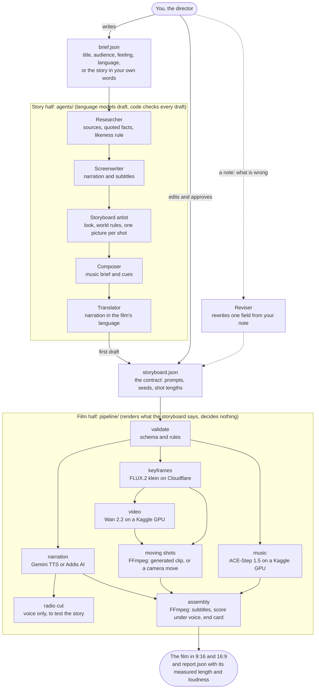

# Heritage Short

A pipeline that turns a title into a 60–90 second narrated short film.

You give it a title, an audience and a feeling. Agents research the title and draft a storyboard. You direct the storyboard. Code then renders it: pictures, camera moves, a narrator, a score, subtitles and an end card, exported tall (9:16) and wide (16:9).

The film in this repo is about Gebisa Ejeta, the Ethiopian plant scientist who bred sorghum that survives drought and the parasitic weed striga. It was made for the 10 Academy "Heritage Short" assignment.

## Make the film

```
make film
```

That runs every stage in order and writes:

```
films/gebisa-ejeta/outputs/film/film_9x16.mp4
films/gebisa-ejeta/outputs/film/film_16x9.mp4
films/gebisa-ejeta/outputs/film/report.json    measured length, loudness and subtitles
```

### What you need first

| Need | Why | Check |
|---|---|---|
| Python 3.11 or newer | the pipeline | `python3 --version` |
| FFmpeg | camera moves, mixing, export | `ffmpeg -version` |
| make | runs the commands | `make --version` |

`make film` creates its own Python environment in `.venv` the first time.

### Do you need API keys?

**Not to rebuild this film.** The pictures, narration and score that the models made are committed, along with a record of the inputs each was made from. `make film` sees they are up to date, calls no model, and only does the local work: it re-renders the camera moves and cuts the film together in FFmpeg. That takes a few minutes and costs nothing.

**Yes, to change the film or make a new one.** Copy `.env.example` to `.env` and fill in:

| Key | Used for | Where to get it |
|---|---|---|
| `GEMINI_API_KEY` | facts, script, narrator's voice | https://aistudio.google.com/apikey |
| `CLOUDFLARE_ACCOUNT_ID`, `CLOUDFLARE_API_TOKEN` | pictures | Cloudflare dashboard, AI, Workers AI, Use REST API |
| `KAGGLE_USERNAME`, `KAGGLE_API_TOKEN` | score and generated video (needs a phone-verified account for GPU) | https://www.kaggle.com/settings, API, Generate New Token |

All three have free tiers and none needs a payment card. `.env` is ignored by git.

## Change one shot

Open `films/gebisa-ejeta/storyboard.json`, change one shot's `image_prompt` or its narration line, and run `make film` again. Only that shot's picture or audio is regenerated; everything else is reused. `runs.jsonl` gains one line per new model call, which is how you can see it.

## Direct it with a note

You do not have to edit the storyboard by hand. Say what is wrong with one thing and how to fix it:

```
python -m agents.reviser --film gebisa-ejeta --target picture --shot s08 --note "There are three hands. Show only two."
```

The Reviser rewrites that one picture's description and the picture is repainted; nothing else is touched. The same works for a narration `line`, a shot's `motion`, the `score` brief, the film's `look`, and its `world` (who and where). On the production board each picture and line has a button for this. Every note is kept in `films/<name>/direction.jsonl`.

## Make a film of your own

```
make new TITLE="Lalibela"          # creates films/lalibela/brief.json
```

Write the audience and the feeling in that brief, then:

```
make research FILM=lalibela        # sourced facts about the title
make story FILM=lalibela           # agents draft films/lalibela/storyboard.json
```

Read the storyboard and change whatever you want: it is yours from here, and the agents never overwrite it. Then:

```
make radio FILM=lalibela           # narration over a black screen, to test the story on people
make film FILM=lalibela            # the film
```

If the story is not on Wikipedia, tell it yourself:

```
python -m core.films new --title "Almaz and the last coffee tree" --story "Almaz was born in 1948 near Jimma ..." --languages am
```

The narration may then only use what you wrote. On the production board the same form has a box for the story and a list of narration languages, and each stage has a button to run it.

Otherwise the title must match the name of an English Wikipedia article. Add pages you trust under `sources` in the brief for more facts. If the title is a living person, the pipeline refuses to show or voice them.

## Every command

Each one works on one film, chosen with `FILM=<name>`. The default is `gebisa-ejeta`.

| Command | What it does |
|---|---|
| `make film` | every stage in order: validate, voice, pictures, moving shots, music, edit |
| `make new TITLE="..."` | start a film from a title |
| `make research` | read the sources and list quoted facts |
| `make story` | draft the storyboard from the facts |
| `make validate` | check the brief and storyboard against `schema/` |
| `make narration` | speak each narration line, one file per shot |
| `make radio` | the radio cut: narration over placeholder music |
| `make keyframes` | one picture per shot |
| `make video` | animate the pictures with Wan 2.2 on a Kaggle GPU (can take hours) |
| `make shots` | one clip per shot: the generated clip if there is one, otherwise a camera move over the picture |
| `make music` | three score candidates, on a Kaggle GPU |
| `make assemble` | cut the film together |
| `make status` | where the film is, as JSON |
| `make costs` | rewrite `COSTS.md` from the run log |
| `make test` | the test suite: no network, no keys |
| `make board` | the production board at http://127.0.0.1:3000 (needs Node.js; the pipeline does not) |

## What it costs

Nothing was paid: every model call used a free tier. Measured time per stage, GPU minutes and every service's failure count are in [COSTS.md](COSTS.md), which is generated from `runs.jsonl`.

The real limits are the free tiers' rate limits, not money. See [FAILURES.md](FAILURES.md) for what they did to this project.

## How it is built

A film starts as a brief you write. Agents draft a storyboard from it, you direct and approve the storyboard, and the stages render it. Every command works on one film under `films/<name>/`.



Every stage makes its model calls the same way, which is what makes a re-run cheap and a failure survivable:

```mermaid
flowchart LR
    stage["A stage needs<br/>one picture, line or clip"] --> hash{"Same inputs<br/>as last time?"}
    hash -- yes --> reuse["Reuse the file<br/>no model call"]
    hash -- no --> call["Call the model"]
    call --> ok{"Worked?"}
    ok -- yes --> save["Save the file<br/>and its input hash"]
    ok -- "no, up to 3 tries" --> call
    ok -- "still no" --> fallback["Fallback<br/>next model, or a camera move<br/>over the picture"]
    fallback --> save
    call -. "every attempt" .-> log[("runs.jsonl<br/>model, parameters, seed,<br/>latency, cost")]
```

| Folder | Holds |
|---|---|
| `agents/` | the story half: Researcher, Screenwriter, Storyboard artist, Composer |
| `pipeline/` | the film half: one script per stage |
| `core/` | shared plumbing: validation, run log, cache, model clients |
| `schema/` | JSON Schemas for the brief, the facts and the storyboard |
| `films/` | one folder per film: brief, storyboard, research, outputs, cache |
| `frontend/` | the production board (Next.js) |
| `tests/` | unit tests |
| `runs.jsonl` | one line per attempt at a model call or fetch: model, parameters, seed, latency, cost |

| Document | Covers |
|---|---|
| [ARCHITECTURE.md](ARCHITECTURE.md) | why it is shaped this way: contracts, caching, failure handling |
| [DESIGN.md](DESIGN.md) | audience, intent and the user tests |
| [EXPERIMENTS.md](EXPERIMENTS.md) | what was tried, with results |
| [FAILURES.md](FAILURES.md) | what broke and what fixed it |
| [COSTS.md](COSTS.md) | measured time and usage |
| [ETHICS.md](ETHICS.md) | consent, sources, licences, labelling |
| [REPORT.md](REPORT.md) | the project report |
| [AGENTS.md](AGENTS.md) | the rules any coding agent follows in this repo |

## Limits to know about

- Generated video is made at 480p on a free GPU and enlarged, so moving shots are softer than the still pictures. A shot the video model did not make gets a camera move over its picture instead.
- Narration in Amharic works as far as the script and the voice, but the automatic check on the recording is not reliable in Amharic (EXPERIMENTS.md, E8). An Amharic speaker must listen to every line.
- The free voice quota is about three dozen lines a day. The second film, `films/abebe-bikila`, is unfinished because it ran out with two lines to record (FAILURES.md, F7).
- The narration and the film were checked by measurement and by machine transcription, because the coding agent that built this cannot hear or watch. A person should listen before publishing.

This film was made with AI: the facts were selected, and the script, pictures, voice and score were generated, by models. A person chose the subject, the audience and the feeling.
